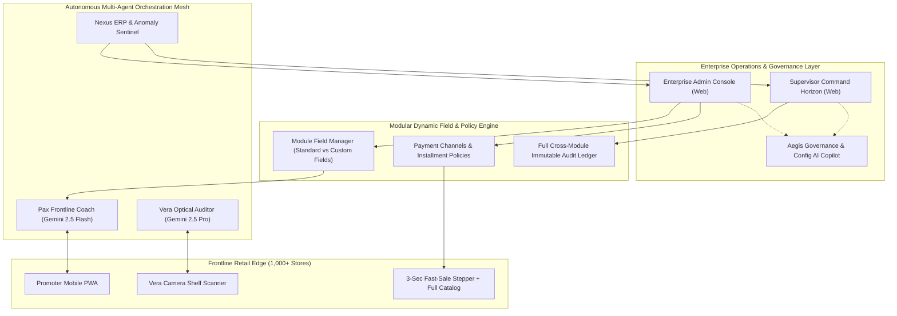
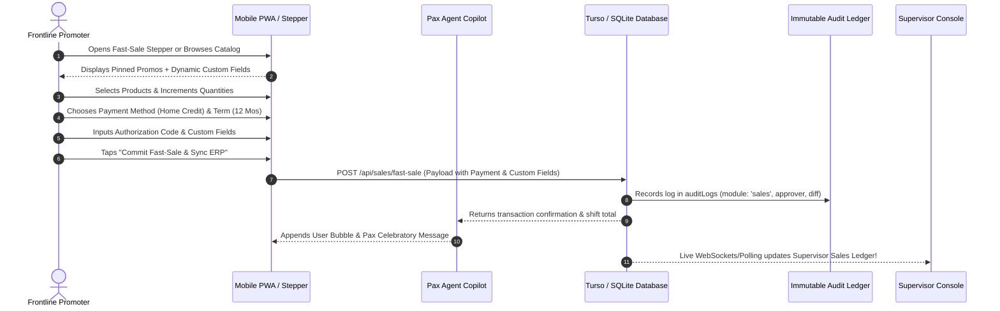

# Project BLOC: Enterprise Retail Operations & Frontline Agentic Platform
## Master System Architecture, UI/UX Navigation & Scalability Specification (v4.0)

**Author**: Principal Enterprise Solutions Architect & Lead UI/UX Systems Architect  
**Project**: Project BLOC (Frontline Agentic Orchestration Engine)  
**Target Enterprise**: Distributed Multi-Store Retail Networks across JAPAC (1,000+ Branches, 5,000+ Frontline Personnel)  
**Hackathon Event**: Google Cloud AI Builder Cup 2026  
**Repository**: [github.com/juanlohika-dev/bloc-retailops-ai](https://github.com/juanlohika-dev/bloc-retailops-ai)  

---

## Executive Summary & Design Philosophy

Project BLOC addresses the fundamental operational breakdown in high-volume, distributed frontline retail operations. Legacy retail management systems force frontline workers through rigid 15-field forms and leave store supervisors with read-only dashboards that cannot take action or properly segregate operational entries.

This master specification establishes the definitive architecture for:
1. **Dynamic Field Configuration Engine**: Moving beyond static, hardcoded fields to a flexible **Standard vs. Custom Fields Engine** configurable per module (`sales`, `stores`, `products`, `users`, `tasks`, `shelf_audits`).
2. **Supervisor Operations Horizon & Segregated Entry Ledgers**: Providing a dedicated, full-featured navigation menu for supervisors with specialized, segregated ledgers for **Sales Entries**, **Vera Shelf Audits**, **Attendance & Shifts**, and **Field Exceptions**.
3. **Ergonomic Frontline Sales Recording Workflow**: A sequential, friction-free transaction lifecycle combining 1-tap pinned promo items, full-catalog search/scan, and dynamic financing fields.
4. **Structured Executive Reports Registry**: Transitioning from a single generic report card into a structured **Report Entry Catalog** with distinct report archetypes, date-cycle filters, and Gemini-synthesized insights.
5. **Massive Scalability Architecture (1,000+ Stores, 5,000+ Staff)**: Scalable multi-tier organizational hierarchy, lazy-loaded tree nodes, server-side pagination, index strategies, and fast search indexing.



---

## 1. Modular Dynamic Field Configuration Engine (Standard vs Custom Fields)

### 1.1 Problem Statement & Architectural Transition
In enterprise retail operations, different retail organizations, regional markets, and product categories require distinct transactional attributes:
- A consumer electronics retail chain requires *Serial Number*, *Warranty Term*, *IMEI Code*, *Down Payment Amount*, and *Financing Partner Reference*.
- An FMCG or beauty retail chain requires *Batch/Lot Code*, *Sampler Given (Yes/No)*, *Bundle Discount Code*, and *Customer Loyalty Tier*.

Hardcoding fields directly into a single UI widget breaks extensibility. Instead, Project BLOC adopts an enterprise **Metadata-Driven Field Architecture** (similar to Salesforce Custom Objects or SAP Extensibility Framework).

### 1.2 Enterprise Modules & Standard vs Custom Fields Matrix

Every operational module maintains **Standard Fields** (immutable system attributes essential for core business logic) and **Custom Fields** (dynamically provisioned by Administrators in Admin Settings):

| Module | Standard Fields (System Enforced) | Allowable Custom Field Archetypes |
| :--- | :--- | :--- |
| **`sales` (Sales Transactions)** | • Transaction ID (`id`)<br>• Store ID (`storeId`)<br>• User/Promoter ID (`userId`)<br>• Timestamp (`timestamp`)<br>• Items & Quantities (`items`)<br>• Total Amount & Currency (`totalAmount`, `currency`)<br>• Payment Method (`paymentMethod`)<br>• Payment Terms (`paymentTerms`) | • Customer Phone / Loyalty ID (Text)<br>• Serial / IMEI Numbers (Text / Array)<br>• Down Payment Amount (Currency)<br>• Extended Warranty Pack (Select / Dropdown)<br>• Gift with Purchase / Freebie Tag (Checkbox)<br>• Delivery / Store Pickup (Select) |
| **`stores` (Retail Store Network)** | • Store Code (`storeCode`)<br>• Store Name (`name`)<br>• Retail Chain (`chain`)<br>• Country & City (`country`, `city`)<br>• Latitude & Longitude (`lat`, `lng`)<br>• Geofence Radius (`geofenceRadiusMeters`)<br>• Default Daily Quota (`dailyTargetDefault`) | • Mall Floor / Unit Number (Text)<br>• Store Format Tier (Flagship, High-Street, Kiosk)<br>• Partner POS Terminal ID (Text)<br>• Store Manager Phone (Text)<br>• Operating Hours (Opening / Closing Time) |
| **`products` (SKU Catalog)** | • SKU Code (`skuCode`)<br>• Product Name (`name`)<br>• Category (`category`)<br>• Unit Price & Currency (`unitPrice`, `currency`)<br>• Barcode / QR (`barcode`)<br>• Focus Promo Pin (`isFocusPromo`)<br>• Direct Commission (`commissionPerUnit`) | • Brand / Sub-Brand (Select)<br>• Color / Variant (Text)<br>• Minimum Advertised Price (MAP) (Currency)<br>• Shelf Facing Requirement (Number)<br>• Bundle Eligibility Tag (Checkbox) |
| **`users` (Staff & Personnel)** | • User ID (`id`)<br>• Full Name (`name`)<br>• Email & Phone (`email`, `phone`)<br>• System Role (`role`)<br>• Preferred Native Language (`preferredLanguage`)<br>• Active Status (`active`) | • Employee Government ID / Tax ID (Text)<br>• Agency / Vendor Partner Name (Text)<br>• Emergency Contact (Text)<br>• Uniform Size (Select)<br>• Direct Commission Bank Account (Text) |
| **`tasks` (Autonomous Tasks)** | • Task Title (`title`)<br>• Target Agent (`agentId`)<br>• Cadence / Cron (`scheduleCron`)<br>• Target Scope (`targetScope`)<br>• Prompt Instructions (`promptTemplate`) | • Priority Level (High, Medium, Normal)<br>• SLA Completion Window (Minutes)<br>• Mandatory Photo Flag (Checkbox)<br>• Supervisor Alert Threshold (Percentage) |
| **`shelf_audits` (Vera Vision)** | • Audit ID (`id`)<br>• Shift ID (`shiftId`)<br>• Compliance Score (`complianceScore`)<br>• Share of Shelf % (`shareOfShelfPct`)<br>• Gemini Verdict (`geminiVerdict`)<br>• Photo Drive ID (`photoDriveId`) | • Endcap Location Number (Text)<br>• Competitor Facing Count (Number)<br>• POP Material Installed (Checkbox)<br>• Price Tag Mismatch Flag (Checkbox) |

### 1.3 Database Schema for Dynamic Field Engine

```typescript
// src/db/schema.ts - Dynamic Field Engine Extensions

export const moduleFieldDefinitions = sqliteTable('module_field_definitions', {
  id: text('id').primaryKey(),                                  // e.g. "field-sales-cust-phone"
  workspaceId: text('workspace_id').notNull().references(() => workspaces.id),
  module: text('module').notNull(),                             // 'sales' | 'stores' | 'products' | 'users' | 'tasks' | 'shelf_audits'
  fieldKey: text('field_key').notNull(),                         // e.g. "customer_phone", "serial_number"
  fieldLabel: text('field_label').notNull(),                     // e.g. "Customer Phone / Loyalty #"
  fieldType: text('field_type').notNull(),                       // 'text' | 'number' | 'select' | 'checkbox' | 'date' | 'currency'
  isStandard: integer('is_standard', { mode: 'boolean' }).default(false), // true = core system attribute, false = custom
  isRequired: integer('is_required', { mode: 'boolean' }).default(false),
  options: text('options', { mode: 'json' }),                    // For 'select' type: ["None", "1 Year Extended", "2 Year Care"]
  defaultValue: text('default_value'),
  placeholder: text('placeholder'),
  displayOrder: integer('display_order').default(0),
  active: integer('active', { mode: 'boolean' }).default(true),
  createdAt: integer('created_at', { mode: 'timestamp' }).notNull(),
});

// JSON storage pattern for custom fields on core records
// salesTransactions.customFields -> { "customer_phone": "+639171234567", "warranty_pack": "2 Year Care" }
```

### 1.4 Admin Console UI: Enterprise Module Field Builder
Located under **Admin Console &rarr; Settings &rarr; Module Fields & Extensibility**:
- **Module Selector Tabs**: `[ Sales Transactions ]` `[ Stores ]` `[ Products ]` `[ Users & Roster ]` `[ Tasks ]` `[ Shelf Audits ]`
- **Standard System Fields (Locked Table)**: Displays fixed system fields with field key, type, and required status (read-only for system integrity).
- **Custom Dynamic Fields (Interactive Builder Table)**:
  - List of active custom fields.
  - Switch: Enable / Disable field on frontline forms.
  - Switch: Mark as Mandatory / Optional.
  - Button: `+ Add Custom Field` &rarr; Modal with Field Key, Label, Type, Dropdown Options, and Frontline Tooltip.
  - All changes trigger an immediate entry in `auditLogs` under module `config`!

---

## 2. Supervisor Operations Horizon & Segregated Entry Ledgers

### 2.1 The Critical Gap in Existing Supervisor Tooling
As identified by operational leads, the Supervisor view previously presented an aggregated summary without a **dedicated navigation menu** or **segregated entry ledgers**. Supervisors could not find where individual sales entries, shelf optical audits, and shift attendances were logged.

### 2.2 Supervisor Information Architecture (Navigation Blueprint)

The **Supervisor Operations Horizon** is equipped with its own dedicated left navigation sidebar and specialized operational entry views:

```text
┌──────────────────────────────────────────────────────────────────────────────────────────────────┐
│ [🏢 Samsung Southeast Asia]  [Supervisor Mode: Sarah Tan (Metro Manila Area)]   [Ask Aegis Copilot]│
├──────────────────────┬───────────────────────────────────────────────────────────────────────────┤
│ 🛰️ Live Command     │  REGIONAL SUPERVISOR COMMAND HORIZON                                      │
│    Horizon           │  ┌──────────────────────┬──────────────────────┬──────────────────────┐   │
│                      │  │ $18,450 Shift Rev    │ 92% Shelf Compliance │ 14/14 Staff Active   │   │
│ 💳 Sales & Fast-Sale │  └──────────────────────┴──────────────────────┴──────────────────────┘   │
│    Entries Ledger    │                                                                           │
│                      │  Live Operational Alerts (3 Outliers Requiring Supervisor Attention):     │
│ 📷 Vera Shelf Photo  │  • SM Megamall: Missing Facing detected by Vera (11:15 AM)                │
│    Audits Ledger     │  • Robinsons Galleria: Home Credit 24m transaction pending supervisor code │
│                      │  • FairPrice VivoCity: Promoter check-in 12m late (Pax re-prompt sent)    │
│ ⏰ Attendance & Shift│                                                                           │
│    Roster            │  Territory Retail Branches Performance (Pacing vs Quotas)                 │
│                      │  [SM Megamall: 78% Pacing] [Robinsons: 92% Pacing] [Ayala Mall: 45% Pacing]│
│ ⚠️ Field Exceptions  │                                                                           │
│    & Approvals       │                                                                           │
│                      │                                                                           │
│ 🏬 Territory Store   │                                                                           │
│    Network (360°)    │                                                                           │
│                      │                                                                           │
│ 👥 Frontline Staff   │                                                                           │
│    Roster & Dialect  │                                                                           │
└──────────────────────┴───────────────────────────────────────────────────────────────────────────┘
```

### 2.3 Detailed Specification of the 7 Supervisor Domain Ledgers

#### Ledger 1: Sales & Fast-Sale Entries Ledger (`#supPanelSales`)
- **Purpose**: Real-time operational stream of every transaction logged across all stores in the supervisor's assigned territory.
- **Header Filters**:
  - Filter by Store: `[All Stores ▼]` `[SM Megamall]` `[Robinsons Galleria]` `[Ayala Mall]`
  - Filter by Payment Method: `[All Methods ▼]` `[Cash]` `[Credit Card]` `[Home Credit]` `[E-Wallet]`
  - Filter by Financing Term: `[Straight]` `[3 Mos]` `[6 Mos]` `[12 Mos]` `[24 Mos]`
  - Search Input: Search by Transaction ID, Receipt #, Promoter Name, or SKU Code.
- **Columns**:
  1. `Timestamp & Transaction ID`: Precise time (e.g. `11:42:15 AM`) + `tx-9a82b4`.
  2. `Store & Branch`: Store code, chain badge, and location.
  3. `Promoter / Sales Rep`: Frontline actor who logged the sale.
  4. `SKUs & Quantities`: Item count and SKU pills with quantity badges.
  5. `Payment Channel & Terms`: Color-coded payment method badge + financing term (e.g. `[HOME CREDIT · 12 MOS 0% APR]`).
  6. `Approval Code`: Verification reference (e.g. `HC-88192` or `AUTH-918234`).
  7. `Total Settlement`: Total transaction value in branch currency.
  8. `Actions`: `[Inspect Receipt Breakdown]` button (opens detailed transaction drawer with unit prices, promoter commission earned, and dynamic custom field values).

#### Ledger 2: Vera Shelf Photo Audits Ledger (`#supPanelAudits`)
- **Purpose**: Ground-truth visual evidence captured by field promoters and analyzed by Vera (Gemini 2.5 Pro).
- **Columns**:
  1. `Timestamp & Store`: Branch name and upload time.
  2. `Promoter`: Field rep who captured the photo.
  3. `Shelf Photo Thumbnail`: Clickable high-res thumbnail stored in Google Drive.
  4. `Compliance Score`: Percentage score (0–100%) with color-coded health meter.
  5. `Share of Shelf (SoS)`: Brand facings vs competitor facings ratio.
  6. `Gemini AI Optical Verdict`: Exact automated synthesis (e.g. *"Compliant 3-facing layout, but Shelf Tag #4 is missing on upper tier"*).
  7. `Status`: `Compliant`, `Needs Adjustment`, or `Escalated to Supervisor`.
  8. `Action`: `[Inspect Audit Detail]` modal with zoomable photo and corrective action prompt.

#### Ledger 3: Attendance & Shift Roster Ledger (`#supPanelAttendance`)
- **Purpose**: Real-time staff presence verification across retail branches.
- **Columns**:
  1. `Promoter Name`: Staff member identity and avatar.
  2. `Assigned Store`: Scheduled retail branch.
  3. `Shift Date & Scheduled Hours`: e.g. `10:00 AM – 7:00 PM`.
  4. `Clock-In Time`: Precise timestamp.
  5. `GPS Geofence Verification`: Status pill (`✓ GPS Verified within 150m` or `⚠️ Out of Geofence Check-in`).
  6. `Quota Target`: Daily assigned target.
  7. `Current Sell-Through`: Actual sales logged so far today.
  8. `Pax Chat Status`: Native conversation status (e.g. *"Morning mission acknowledged in Tagalog"*).

#### Ledger 4: Field Exceptions & Approvals Ledger (`#supPanelExceptions`)
- **Purpose**: High-priority exceptions requiring supervisor authorization or immediate intervention:
  - High-value bundle discounts exceeding standard threshold.
  - Transactions flagged with invalid approval codes.
  - Planogram non-compliance unresolved after 60-minute automated follow-up.
  - Clock-in delinquencies.
- **Interactive Action**: 1-click `[Authorize Exception]` or `[Dispatch Pax Follow-Up]`.

#### Ledger 5: Territory Store Network (360° Inspection) (`#supPanelStores`)
- **Purpose**: Territory store grid with pacing progress bars, GPS coordinates, assigned staff count, and 1-tap **360° Store Dossier Drawer**.

#### Ledger 6: Territory Frontline Staff Roster (`#supPanelStaff`)
- **Purpose**: Full directory of staff assigned to the supervisor's jurisdiction, their assigned stores, native language preferences, active shifts, and career commission totals.

---

## 3. Frontline Sales Recording Workflow & Full Catalog Navigation

### 3.1 Ergonomic Frontline Workflow
The user specified that the arrangement for recording sales must be logical, seamless, and extensible:
- Promoters must be able to tap **1-Tap Focus Promo Pins** for campaign SKUs OR browse the **Full SKU Catalog**.
- Standard fields (items, quantities, payment method, payment terms, approval reference) must flow naturally into dynamic custom fields.
- The transaction must immediately write to the database, trigger Pax AI celebration, log an audit trail entry, and update supervisor/executive ledgers in real time.



### 3.2 3-Step Frontline Sales Interface Blueprint

```text
┌────────────────────────────────────────────────────────┐
│ 🛒 FAST-SALE QUICK STEPPER & SETTLEMENT ENGINE         │
├────────────────────────────────────────────────────────┤
│ [ STEP 1: SELECT ITEMS FROM CATALOG ]                  │
│                                                        │
│ Pinned Focus Campaign Promos:                          │
│ ┌────────────────────────────────────────────────────┐ │
│ │ 📺 55" 4K OLED Smart TV (OLED-55-B4)               │ │
│ │ Price: $1,299  | Bonus Comm: +$45.00               │ │
│ │ [-] [ 1 ] [+]                                      │ │
│ └────────────────────────────────────────────────────┘ │
│ ┌────────────────────────────────────────────────────┐ │
│ │ 🔊 Dolby Atmos Soundbar (SND-ATMOS-01)             │ │
│ │ Price: $349    | Bonus Comm: +$15.00               │ │
│ │ [-] [ 0 ] [+]                                      │ │
│ └────────────────────────────────────────────────────┘ │
│ [ 🔍 Browse Full Catalog / Camera Barcode Scan ]       │
├────────────────────────────────────────────────────────┤
│ [ STEP 2: PAYMENT METHOD & FINANCING SETTLEMENT ]      │
│                                                        │
│ Settlement Channel:                                    │
│ [ Cash ] [ Credit Card ] [ 🤝 Home Credit ] [ E-Wallet]│
│                                                        │
│ Financing Terms (0% APR Partner):                      │
│ [ Straight ] [ 3 Mos (0%) ] [ 6 Mos (0%) ] [ 12 Mos ]  │
│                                                        │
│ Approval / Ref Code:                                   │
│ [ HC-918284-AUTH                                     ]│
├────────────────────────────────────────────────────────┤
│ [ STEP 3: DYNAMIC TRANSACTION CUSTOM FIELDS ]          │
│                                                        │
│ Customer Phone / Loyalty ID (Optional):                │
│ [ +63 917 882 1923                                   ]│
│                                                        │
│ Extended Warranty Pack:                                │
│ [ 2-Year Platinum Care (+$89) ▼                      ]│
├────────────────────────────────────────────────────────┤
│ Subtotal: $1,299.00 | Promoter Bonus: +$45.00          │
│ [ 🚀 COMMIT FAST-SALE & SYNC ERP (1-TAP) ]             │
└────────────────────────────────────────────────────────┘
```

---

## 4. Executive Reports Architecture (From Single Summary to Structured Report Catalog)

### 4.1 The Need for Structured Report Entries
In enterprise operations, executives do not rely on a single generic report. Executives require **distinct, scheduled, and on-demand Report Entries** segregated by business domain.

### 4.2 Report Archetype Registry

| Report Archetype | Domain Focus | Key Synthesis Metrics | Gemini Strategic Analysis |
| :--- | :--- | :--- | :--- |
| **1. Executive Sell-Through & Revenue Reconciliation** | Financial & Sales | • Total Gross Revenue<br>• Normalized USD/SGD Total<br>• Pacing vs Quota %<br>• Day-over-Day Velocity | Identifies revenue gaps across chains; recommends reallocation of promo incentives to lagging stores. |
| **2. Multimodal Planogram & Shelf Compliance Audit** | Visual Merchandising | • Average Compliance %<br>• Share of Shelf (SoS) %<br>• Total Photo Audits Analyzed<br>• Out-of-Stock (OOS) Incidents | Highlights stores with recurring misaligned facings; recommends optical retraining for delinquent branches. |
| **3. Frontline Promoter Performance & Commission Ledger** | HR & Field Operations | • Promoters on Duty<br>• Quota Achievement % by Rep<br>• Commission Payout Accruals<br>• Attendance & Geofence Rate | Evaluates top-tier reps vs underperformers; flags roving promoters exceeding targets. |
| **4. Payment Channel Settlement & Financing Mix** | Treasury & Financing | • Cash vs Card vs Home Credit %<br>• Installment Term Breakdown<br>• Average Ticket per Channel<br>• Financing Approval Rate | Analyzes customer adoption of 0% installment plans; evaluates merchant financing partners. |
| **5. Out-of-Stock (OOS) Gap & Replenishment Urgency** | Supply Chain & Logistics | • Flagged Stockouts Count<br>• High-Velocity SKU Depletions<br>• Days of Inventory Remaining<br>• Critical Replenishment Alerts | Triggers automated restocking notices to central warehouse for fast-moving promotional SKUs. |

### 4.3 Report Entry Data Model & UI Representation

```typescript
// src/db/schema.ts - Executive Reports Table Structure

export const executiveReports = sqliteTable('executive_reports', {
  id: text('id').primaryKey(),                                  // e.g. "rep-2026-w42-sales"
  workspaceId: text('workspace_id').notNull().references(() => workspaces.id),
  reportType: text('report_type').notNull(),                    // 'revenue_reconciliation' | 'planogram_compliance' | 'promoter_performance' | 'payment_mix' | 'stockout_urgency'
  title: text('title').notNull(),                               // e.g. "Q4 Midday Multi-Store Sell-Through & Financial Digest"
  period: text('period').notNull(),                             // "Daily Shift (2026-10-14)", "Weekly Cycle W42"
  scope: text('scope').notNull().default('all_stores'),         // 'all_stores', 'chain:SM Supermalls', 'region:PH'
  summary: text('summary').notNull(),                           // High-level Gemini executive synthesis
  keyFindings: text('key_findings', { mode: 'json' }),           // Array of strategic bullet points
  dataBreakdown: text('data_breakdown', { mode: 'json' }),       // Structured metric tables and charts
  status: text('status').notNull().default('audited'),          // 'draft' | 'audited' | 'published'
  generatedBy: text('generated_by').notNull().default('gemini-2.5-flash'),
  createdAt: integer('created_at', { mode: 'timestamp' }).notNull(),
});
```

---

## 5. Massive Scalability Architecture (1,000+ Stores, 5,000+ Staff)

### 5.1 The Scalability Challenge
When a retail network scales to **1,000 stores** across Southeast Asia with **5,000 promoters**:
- Returning all 1,000 stores or 5,000 users in a single un-paginated JSON payload crashes client browsers and causes database connection starvation.
- Rendering 1,000 uncollapsed DOM elements in an organizational tree freezes the UI thread.
- Supervisors cannot scroll through a flat list of 1,000 stores to find their 12 assigned branches.

### 5.2 5-Tier Scalable Organizational Hierarchy Topology

To accommodate 1,000+ stores seamlessly, the organizational hierarchy follows a structured multi-level tree with dynamic parent-child nesting:

```text
Level 0: Global Enterprise HQ (e.g. JAPAC Retail Operations HQ)
  │
  ├── Level 1: Country / Regional Operating Hubs (e.g. Philippines Hub, Singapore Hub, Malaysia Hub)
  │     │
  │     ├── Level 2: Area / District Operations (e.g. Metro Manila North, Central Luzon, Mindanao)
  │     │     │
  │     │     ├── Level 3: Territory Store Clusters (e.g. Tier-1 SM Malls Cluster, Hypermarket Group)
  │     │     │     │
  │     │     │     └── Level 4: Individual Retail Store Branches (e.g. SM Megamall Branch #01)
  │     │     │           │
  │     │     │           └── Level 5: On-Duty Promoters & Merchandisers (Liza Santos, Marco Diaz)
```

### 5.3 Technical Scalability Blueprint

#### 1. Server-Side Pagination & Cursor-Based Streaming
All list endpoints enforce mandatory pagination with a default page size of 25 (max 100):
```http
GET /api/admin/:ws/stores?limit=25&offset=0&region=PH&chain=SM&search=Megamall
GET /api/admin/:ws/users?limit=25&offset=0&role=promoter&storeId=store-sm-mega
GET /api/admin/:ws/sales?limit=50&cursor=tx-179193&storeId=store-sm-mega
```

#### 2. Lazy-Loaded Hierarchical Tree UI (Virtual DOM)
- Top-level root nodes (HQ and Regional Hubs) are loaded initially.
- Sub-nodes are rendered collapsed with an expand toggle `[ ▶ ]`.
- When an administrator expands a node, child clusters are fetched on demand via `GET /api/admin/:ws/org-nodes?parentId=:id`.
- The UI maintains instantaneous 60 FPS scrolling even with 10,000 total nodes.

#### 3. Search-First Navigation & Instant Filter Indices
- **Fast Filter Bar**: Search by store name, branch code (`SM-MEGA-01`), city, or country.
- **Indexed Database Queries**:
  - `CREATE INDEX idx_stores_ws_country ON stores(workspace_id, country);`
  - `CREATE INDEX idx_sales_ws_timestamp ON sales_transactions(workspace_id, timestamp);`
  - `CREATE INDEX idx_org_nodes_parent ON org_nodes(workspace_id, parent_id);`
  - `CREATE INDEX idx_users_ws_store ON users(workspace_id, role);`

#### 4. Aggregated Rollups at Every Level
Instead of computing sums across 1,000 stores in real time on the web client, the system aggregates metrics hierarchically:
- Store Level: Store actual sales & pacing vs daily target.
- Territory Level: Sum of stores in territory cluster.
- Area Level: Sum of territories in district.
- Regional Level: Sum of areas in country hub.

---

## 6. Implementation Specifications & File Mapping

| Component | Target File | Implementation Deliverables |
| :--- | :--- | :--- |
| **Dynamic Fields Engine** | [`src/db/schema.ts`](file:///c:/Users/Lester%20Alarcon/Documents/Bloc%20Retail%20Ops/src/db/schema.ts)<br>[`src/api/admin.ts`](file:///c:/Users/Lester%20Alarcon/Documents/Bloc%20Retail%20Ops/src/api/admin.ts) | • `moduleFieldDefinitions` schema table.<br>• `GET/POST/PUT /api/admin/:ws/fields/:module` endpoints.<br>• Custom fields validation & storage on sales transactions. |
| **Supervisor Navigation & Ledgers** | [`src/web/index.html`](file:///c:/Users/Lester%20Alarcon/Documents/Bloc%20Retail%20Ops/src/web/index.html)<br>[`src/api/supervisor.ts`](file:///c:/Users/Lester%20Alarcon/Documents/Bloc%20Retail%20Ops/src/api/supervisor.ts) | • Left navigation menu for Supervisor Console.<br>• 7 dedicated views: Command Horizon, Sales Ledger, Vera Audits, Attendance, Exceptions, Stores, Staff Roster.<br>• Search, store filtering, and receipt inspection drawers. |
| **Sales Stepper & Catalog** | [`src/web/index.html`](file:///c:/Users/Lester%20Alarcon/Documents/Bloc%20Retail%20Ops/src/web/index.html)<br>[`src/agents/pax/index.ts`](file:///c:/Users/Lester%20Alarcon/Documents/Bloc%20Retail%20Ops/src/agents/pax/index.ts) | • Clean 3-step Fast-Sale workflow with dynamic custom fields.<br>• Full catalog browsing drawer with instant search and barcode scan.<br>• Real-time Pax AI confirmation in chat stream. |
| **Executive Reports Catalog** | [`src/api/admin.ts`](file:///c:/Users/Lester%20Alarcon/Documents/Bloc%20Retail%20Ops/src/api/admin.ts)<br>[`src/web/index.html`](file:///c:/Users/Lester%20Alarcon/Documents/Bloc%20Retail%20Ops/src/web/index.html) | • 5 distinct report archetypes in `executiveReports` table.<br>• Multi-report entry catalog with date cycle & store filters.<br>• Detailed report inspection modal with Gemini strategic insights and data tables. |
| **1,000+ Store Scalability** | [`src/db/schema.ts`](file:///c:/Users/Lester%20Alarcon/Documents/Bloc%20Retail%20Ops/src/db/schema.ts)<br>[`src/api/admin.ts`](file:///c:/Users/Lester%20Alarcon/Documents/Bloc%20Retail%20Ops/src/api/admin.ts)<br>[`src/web/index.html`](file:///c:/Users/Lester%20Alarcon/Documents/Bloc%20Retail%20Ops/src/web/index.html) | • Multi-tier hierarchical Org Chart with expandable tree nodes.<br>• Server-side pagination and indexed search across stores and staff.<br>• Hierarchical rollups for quota and revenue tracking. |

---

## 7. Verification & Quality Assurance Strategy

To ensure zero regression and enterprise robustness, the system is validated through:
1. **Compilation Assurance**: Zero TypeScript compilation errors (`npx tsc --noEmit`).
2. **Browser Subagent E2E Testing**:
   - Verify Admin Module Field Builder: add a custom field to `sales`, verify it reflects in frontline Fast-Sale.
   - Verify Supervisor Navigation: click through all 7 supervisor ledgers, inspect sales transaction details, and verify store filters.
   - Verify Executive Reports Catalog: view multi-report list, generate specific report archetypes, and verify Gemini synthesis.
   - Verify Scalable Org Chart: inspect multi-level hierarchy nesting, expand/collapse nodes, and test search filtering.
3. **Audit Trail Verification**: Verify that every configuration change, sales entry, and supervisor action creates an immutable log entry with digital signatures.
